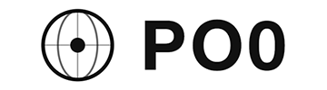

<p align="center">
 
 
<a href="/LICENSE"></a>  
</p>

## 硬件质量体检脚本  -  [Hardware Quality Check Script (EN)](https://github.com/xykt/HardwareQuality/blob/main/README_EN.md)

**支持OS/Platform：Ubuntu | Debian | Linux Mint | Fedora | Red Hat Enterprise Linux (RHEL) | CentOS | Arch Linux | Manjaro | Alpine Linux | AlmaLinux | Rocky Linux | Anolis OS | Alibaba Cloud Linux | SUSE Linux | openSUSE | Void Linux | Windows (via Docker)**

- 中英文双语言支持
- 精美排版，直观显示，多终端单屏优化展示，便于截图分享
- 服务器/VPS虚拟机/容器/裸金属包络ARM/AMD多架构设备
- CPU/GPU/内存/硬盘/主板/声卡/网卡等全面的硬件信息采集
- 自动化sysbench/fio/Geekbench针对CPU/GPU/内存/硬盘作全面测评，可视化基准对比，性能一目了然
- 自动识别操作系统发行版、内核版本与运行环境，了解系统运行状态
- 主板：采集主板型号、BIOS信息与板载设备，包括声卡网卡等，适用于服务器与工控设备识别
- CPU：全面解析CPU型号、架构、核心、线程数与频率信息，烤机测试直观了解性能，同时监测烤机温度，方便评估优化
- 显卡：自动识别独立显卡与集成显卡，解析厂商与设备信息，分析驱动环境，监测温度，直观评分
- 内存：获取总容量、已用/可用内存及使用率，统计内存插槽与条数，测试带宽与延迟，适配多通道与服务器内存配置
- 硬盘：支持SATA/NVMe/RAID设备识别，自动匹配挂载点与测试设备，解析SMART/NVMe健康数据，通过fio性能测试完整模拟CrystalDiskMark/ATTO可视化测试工况
- Json输出便于大数据分析

#### 屏幕截图
|标准测试|
| ---------------- |
||

|硬盘模式|深度模式|
| ---------------- | ---------------- |
|||

## 使用方法

### 便捷模式：交互界面


##### Bash：
````bash
bash <(curl -Ls https://Check.Place) -H
````

##### Docker：
- Linux
````bash
docker run --rm -it --privileged --net=host --pid=host -v /:/host:ro xykt/check -H && docker rmi xykt/check > /dev/null 2>&1
````

- Windows (CMD)
````bash
docker run --rm -it --privileged xykt/check -H & docker rmi xykt/check > NUL 2>&1
````
*Windows架构限制无法获得完整硬件信息*

### 高级模式：参数运行


##### 标准检测：
````bash
bash <(curl -Ls https://Hardware.Check.Place)
````

##### 快速模式：
````bash
bash <(curl -Ls https://Hardware.Check.Place) -F
````

##### 硬盘模式：
````bash
bash <(curl -Ls https://Hardware.Check.Place) -D
````

##### 深度模式：
````bash
bash <(curl -Ls https://Hardware.Check.Place) -V
````

##### 指定硬盘检测路径：
````bash
bash <(curl -Ls https://Hardware.Check.Place) -d /path/to/testdir
````

##### 跳过任意章节：
````bash
bash <(curl -Ls https://Hardware.Check.Place) -S 1234567
````

##### 中英文双语支持：
````bash
bash <(curl -Ls https://Hardware.Check.Place) -l cn|en
````

##### Json输出（[输出示例](https://github.com/xykt/HardwareQuality/blob/main/res/output.json)）：
````bash
bash <(curl -Ls https://Hardware.Check.Place) -j
````

##### 输出报告ANSI/JSON/纯文本至文件：
````bash
bash <(curl -Ls https://Hardware.Check.Place) -o /path/to/file.ansi
bash <(curl -Ls https://Hardware.Check.Place) -o /path/to/file.json
bash <(curl -Ls https://Hardware.Check.Place) -o /path/to/file.txtoranyother
````

##### 跳过检测系统及安装依赖：
````bash
bash <(curl -Ls https://Hardware.Check.Place) -n
````

##### 自动安装依赖：
````bash
bash <(curl -Ls https://Hardware.Check.Place) -y
````

##### 报告展示完整IP地址及路径信息：
````bash
bash <(curl -Ls https://Hardware.Check.Place) -f
````

##### 隐私模式——禁用在线报告生成功能：
````bash
bash <(curl -Ls https://Hardware.Check.Place) -p
````
*由于Geekbench5会强制上传测试结果，因此隐私模式会禁用Geekbench5测试，严格确保0上传*

##### Docker（支持运行参数，须在```&```前插入）（不建议）：
- Linux命令行
````bash
docker run --rm -it --privileged --net=host --pid=host -v /:/host:ro xykt/hardwarequality && docker rmi xykt/hardwarequality > /dev/null 2>&1
````

- Windows (CMD)
````cmd
docker run --rm -it --privileged xykt/hardwarequality & docker rmi xykt/hardwarequality > NUL 2>&1
````
*Windows架构限制无法获得完整硬件信息*

## 脚本更新

2026/02/05 16:50 增加HQ硬件加权评分功能

2026/01/28 20:00 更新深度模式，展示全部测试细节

2026/01/16 00:00 脚本发布

## 脚本贡献

**服务器赞助商（排名不分先后）**

| 赞助商 | 商标 | 网址 | 
| - | - | - |  
| LisaHost</br>丽萨主机 |  | [https://lisahost.com](https://lisahost.com)| 
| KFCHost |  | [https://kfchost.com](https://kfchost.com)|  
| RFCHost |  | [https://rfchost.com](https://rfchost.com)| 
| PO0 |  | [https://po0.io](https://po0.io)| 

##### *E-Mail: sponsor@check.place Telegram Bot: https://t.me/xythebot*
**仅接受长期稳定运营，信誉良好的商家*

**Acknowledgments:**

- 感谢[酒神@Nodeseek](https://www.nodeseek.com/space/9#/general)，你为脚本提供了技术支持及宝贵建议

**Stars History:**


**Daily Runs History:**


