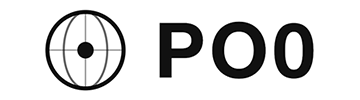

<p align="center">
 
 
<a href="/LICENSE"></a>  
</p>

## Hardware Quality Check Script  -  [硬件质量体检脚本 (CN)](https://github.com/xykt/HardwareQuality)

**Supported OS / Platforms: Ubuntu | Debian | Linux Mint | Fedora | Red Hat Enterprise Linux (RHEL) | CentOS | Arch Linux | Manjaro | Alpine Linux | AlmaLinux | Rocky Linux | Anolis OS | Alibaba Cloud Linux | SUSE Linux | openSUSE | Void Linux | Windows (via Docker)**

- Bilingual support (Chinese / English)
- Elegant layout with intuitive presentation, optimized for single-screen display across multiple terminals, easy to screenshot and share
- Supports servers / VPS virtual machines / containers / bare metal, covering ARM and AMD multi-architecture devices
- Comprehensive hardware information collection for CPU / GPU / memory / disks / motherboard / sound card / network card, etc.
- Automated sysbench / fio / Geekbench tests for CPU / GPU / memory / disks, with visual benchmark comparison for clear performance insight
- Automatically detects operating system distribution, kernel version, and runtime environment to understand system status
- Motherboard: Collects motherboard model, BIOS information, and onboard devices including sound cards and network cards; suitable for server and industrial equipment identification
- CPU: Fully parses CPU model, architecture, cores, threads, and frequency; stress testing provides intuitive performance insight while monitoring temperature for optimization evaluation
- GPU: Automatically detects discrete and integrated GPUs, parses vendor and device information, analyzes driver environment, monitors temperature, and provides intuitive scoring
- Memory: Retrieves total, used/available memory and usage rate; counts memory slots and modules; tests bandwidth and latency; adapts to multi-channel and server memory configurations
- Disk: Supports SATA / NVMe / RAID device detection, automatically matches mount points with test devices, parses SMART / NVMe health data, and uses fio performance tests to fully simulate CrystalDiskMark / ATTO visual test workloads
- JSON output for big data analysis

#### Screenshots
| Standard Test |
| ---------------- |
|  |

| Disk Mode | Verbose Mode |
| ---------------- | ---------------- |
|  |  |

## Usage

### Easy Mode: Interactive Interface


##### Bash：
````bash
bash <(curl -Ls https://Check.Place) -H
````

##### Docker：
- Linux
````bash
docker run --rm -it --privileged --net=host --pid=host -v /:/host:ro xykt/check -H && docker rmi xykt/check > /dev/null 2>&1
````

- Windows (CMD)
````bash
docker run --rm -it --privileged xykt/check -H & docker rmi xykt/check > NUL 2>&1
````
*Due to Windows architecture limitations, full hardware information cannot be obtained*

### Advanced Mode: Run with Parameters


##### Standard Check:
````bash
bash <(curl -Ls https://Hardware.Check.Place)
````

##### Fast Mode:
````bash
bash <(curl -Ls https://Hardware.Check.Place) -F
````

##### Disk Mode:
````bash
bash <(curl -Ls https://Hardware.Check.Place) -D
````

##### Verbose Mode:
````bash
bash <(curl -Ls https://Hardware.Check.Place) -V
````

##### Specify Disk Test Directory:
````bash
bash <(curl -Ls https://Hardware.Check.Place) -d /path/to/testdir
````

##### Skip specific sections:
````bash
bash <(curl -Ls https://Hardware.Check.Place) -S 1234567
````

##### Bilingual support:
````bash
bash <(curl -Ls https://Hardware.Check.Place) -l cn|en
````

##### JSON output（[输出示例](https://github.com/xykt/HardwareQuality/blob/main/res/output.json)）：
````bash
bash <(curl -Ls https://Hardware.Check.Place) -j
````

##### Output report to file in ANSI/JSON/Text format:
````bash
bash <(curl -Ls https://Hardware.Check.Place) -o /path/to/file.ansi
bash <(curl -Ls https://Hardware.Check.Place) -o /path/to/file.json
bash <(curl -Ls https://Hardware.Check.Place) -o /path/to/file.txtoranyother
````

##### Skip checking OS and dependencies:
````bash
bash <(curl -Ls https://Hardware.Check.Place) -n
````

##### Auto-install dependencies:
````bash
bash <(curl -Ls https://Hardware.Check.Place) -y
````

##### Display Full IP Address and Path Information in Report:
````bash
bash <(curl -Ls https://Hardware.Check.Place) -f
````

##### Privacy mode - Disable online report link:
````bash
bash <(curl -Ls https://Hardware.Check.Place) -p
````
*Since Geekbench 5 forcibly uploads test results, Geekbench 5 testing is disabled in privacy mode to strictly ensure zero data uploads.*

##### Docker (supports runtime arguments; insert them before the ```&```):
- Linux命令行
````bash
docker run --rm -it --privileged --net=host --pid=host -v /:/host:ro xykt/hardwarequality && docker rmi xykt/hardwarequality > /dev/null 2>&1
````

- Windows (CMD)
````cmd
docker run --rm -it --privileged xykt/hardwarequality & docker rmi xykt/hardwarequality > NUL 2>&1
````
*Due to Windows architecture limitations, full hardware information cannot be obtained*

## Script Updates

2026/02/05 16:50 Add HQ Weighted Hardware Benchmark

2026/01/28 20:00 Add verbose mode to show benchmark score details

2026/01/16 00:00 Script Released

## Contributions

**Server Sponsors​ *(No ranking implied)*:**

| Sponsor | Logo | Link | 
| - | - | - |  
| LisaHost</br>丽萨主机 |  | [https://lisahost.com](https://lisahost.com)| 
| KFCHost |  | [https://kfchost.com](https://kfchost.com)|  
| RFCHost |  | [https://rfchost.com](https://rfchost.com)| 
| PO0 |  | [https://po0.io](https://po0.io)| 

##### *E-Mail: sponsor@check.place Telegram Bot: https://t.me/xythebot*
**Only accepting merchants with long-term stable operations and good reputation*

**Acknowledgments:**

- Thanks to [酒神@Nodeseek](https://www.nodeseek.com/space/9#/general) for technical support and valuable feedback.

**Stars History:**


**Daily Runs History:**


